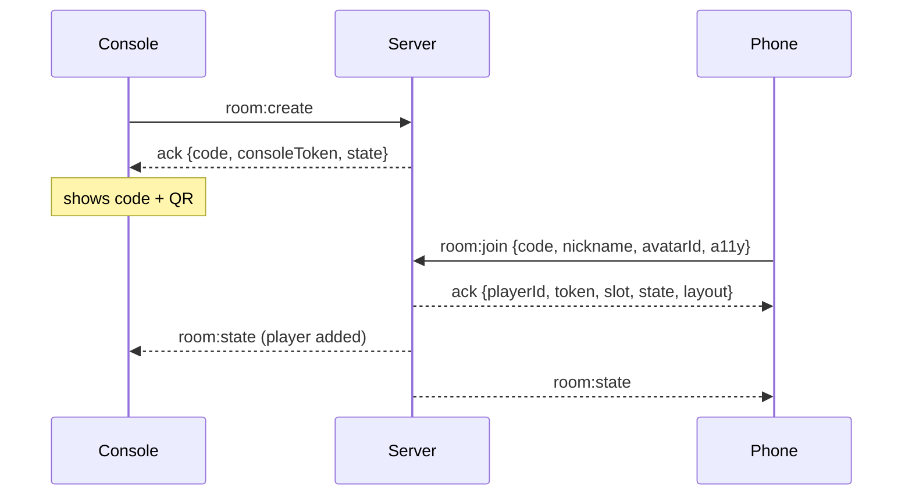
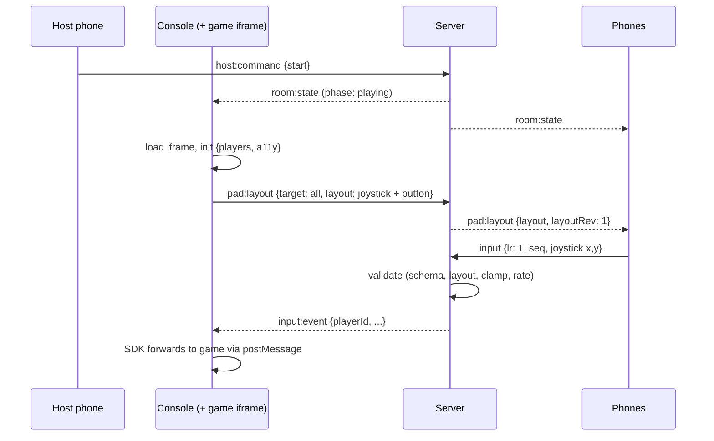
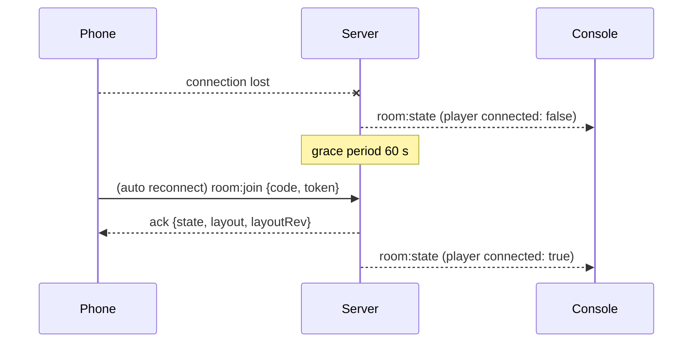

# NexPlay realtime protocol (draft v1)

> Status: **draft**. Source of truth once implemented: the Zod schemas in `packages/protocol`. This document describes them; if they disagree, the schemas win and this file must be fixed.
> Related decisions: [ADR-0003](adr/0003-realtime-transport-socketio.md) (transport), [ADR-0005](adr/0005-protocol-validation-and-server-authority.md) (validation and authority), [ADR-0006](adr/0006-game-isolation-sandboxed-iframe.md) (game isolation).

## 1. Scope and conventions

Two channels exist:

| Channel              | Between                    | Technology                                 |
| -------------------- | -------------------------- | ------------------------------------------ |
| **Platform channel** | console ↔ server ↔ phones  | Socket.IO, WebSocket transport only        |
| **Game channel**     | console page ↔ game iframe | `postMessage` through the SDK (section 14) |

Conventions for the platform channel:

- Event names are `domain:action` (lowercase). Payloads are JSON objects, validated by Zod on the server for **every** incoming event. Invalid payloads are dropped and answered with `INVALID_MESSAGE`.
- Requests that need an answer use Socket.IO **acknowledgements**. The ack always has the shape `{ ok: true, data } | { ok: false, error: { code, message } }`.
- Fire-and-forget events (e.g. `input`) have no ack.
- Messages on one connection are delivered in order (Socket.IO guarantee). Continuous inputs also carry a sequence number so stale ones can be ignored.
- Times are in milliseconds. `t` is a client clock value (`Date.now()`), `st` is a server clock value. Clocks are never compared directly between devices (see section 10).
- Texts are UTF-8 and always rendered as text, never as HTML.

## 2. Roles and identifiers

| Role      | Who                                 | Notes                                                                          |
| --------- | ----------------------------------- | ------------------------------------------------------------------------------ |
| `console` | the screen (TV or computer browser) | Exactly one per room. Runs the game iframe.                                    |
| `pad`     | a player's phone                    | Up to 4 per room (8 is an optional stretch goal).                              |
| host      | the **first player** who joined     | Can choose and start games, kick players. Can change later (optional feature). |

| Identifier         | Format                                                                                                                          | Visibility                                                                                   |
| ------------------ | ------------------------------------------------------------------------------------------------------------------------------- | -------------------------------------------------------------------------------------------- |
| `code` (room code) | 5 chars from `ABCDEFGHJKMNPQRSTUVWXYZ23456789` (no I, L, O, 0, 1), generated with `crypto.randomInt`; input is case-insensitive | public (shown on screen)                                                                     |
| `playerId`         | opaque short string, e.g. `p_7k2f`                                                                                              | public (visible to games)                                                                    |
| `slot`             | integer 0 to 3                                                                                                                  | public (player number, stable during the room)                                               |
| `token`            | 128-bit random string                                                                                                           | **secret**, known only to the phone and the server. Never sent to other clients or to games. |
| `consoleToken`     | 128-bit random string                                                                                                           | **secret**, known only to the console and the server                                         |

## 3. Connection and handshake

Clients connect with:

```ts
io(SERVER_URL, {
  transports: ["websocket"],
  auth: { v: 1, role: "console" | "pad" },
});
```

- `v` is the protocol version. A mismatch is refused with `VERSION_MISMATCH` (the connection is closed).
- The handshake does not create or join a room. That is done with `room:create` / `room:join` (section 5).
- The server sets a maximum payload size (`maxHttpBufferSize`, initial value 64 KB) and applies stricter limits per schema (section 12).

## 4. Room lifecycle

```
            room:create
                │
                ▼
   ┌────────► lobby ──host:start──► playing ◄──resume── paused
   │            ▲                      │  │ pause──────────▲
   │            │                      │  └──────────────────
   │   host:backToLobby                │ game:end / game:crashed
   │            │                      ▼
   └───────── ended ◄──────────────────┘
        (results shown, replay or change game)

 any state ──► closed (console gone too long, idle timeout, room:close)
```

| Phase     | Meaning                                                        |
| --------- | -------------------------------------------------------------- |
| `lobby`   | players join, host selects a game                              |
| `playing` | a game runs in the iframe                                      |
| `paused`  | the game is paused (host command)                              |
| `ended`   | the game ended, results are available; replay or back to lobby |

Closing rules (initial values, tunable by load tests):

- Room closed `CONSOLE_GRACE` = 2 min after the console disconnected without coming back.
- Room closed `IDLE_TIMEOUT` = 30 min without any message from any client.
- Closed rooms send `room:closed` to every client, then disconnect them.

## 5. Events: catalogue

### Client → server

| Event           | From                  | Ack | Purpose                                                        |
| --------------- | --------------------- | --- | -------------------------------------------------------------- |
| `room:create`   | console               | yes | create a room, get `code` and `consoleToken`                   |
| `room:resume`   | console               | yes | reclaim the room after a disconnection                         |
| `room:close`    | console               | yes | close the room                                                 |
| `room:join`     | pad                   | yes | join a room, or reclaim a seat with `token`                    |
| `room:leave`    | pad                   | yes | leave voluntarily                                              |
| `player:update` | pad                   | yes | change nickname, avatar or accessibility preferences           |
| `host:command`  | pad (host) or console | yes | select game, start, kick, pause, resume, replay, back to lobby |
| `pad:layout`    | console               | yes | set the controller layout for all or some players              |
| `private:send`  | console               | no  | private message to one player                                  |
| `haptic:send`   | console               | no  | vibration request for one player                               |
| `game:end`      | console               | yes | the game ended, with scores                                    |
| `game:crashed`  | console               | no  | the watchdog killed the game                                   |
| `input`         | pad                   | no  | a player action                                                |
| `rtt:ping`      | pad or console        | yes | latency measurement                                            |

### Server → client

| Event             | To               | Purpose                                          |
| ----------------- | ---------------- | ------------------------------------------------ |
| `room:state`      | console and pads | full snapshot of the room (sent on every change) |
| `room:closed`     | all              | the room is gone                                 |
| `pad:layout`      | pad              | the layout to display                            |
| `private:message` | one pad          | private text                                     |
| `haptic`          | one pad          | vibration request                                |
| `input:event`     | console          | validated player action                          |
| `kicked`          | one pad          | the host removed this player                     |
| `error`           | any              | asynchronous error (rate limit, etc.)            |

## 6. Room events: payloads

```ts
// room:create  (console)   →  ack data: { code, consoleToken, state: RoomState }
{}

// room:resume  (console)   →  ack data: { state: RoomState }
{ code: string, consoleToken: string }

// room:join  (pad)         →  ack data: { playerId, token, slot, state: RoomState, layout: Layout | null, layoutRev: number }
{
  code: string,
  nickname: string,            // 1 to 16 chars, letters, digits, space, - _ ; trimmed
  avatarId: string,            // one of a fixed list, e.g. "avatar-01" to "avatar-12"
  a11y: A11yPrefs,
  token?: string               // present when reclaiming a seat after a disconnection
}

// player:update (pad)       →  ack data: { state: RoomState }
{ nickname?: string, avatarId?: string, a11y?: Partial<A11yPrefs> }

// room:leave (pad), room:close (console)
{}
```

`room:join` behaviour:

- **No `token`:** a new seat is created if the room has a free slot. Joining during a game is allowed (the SDK tells the game a player arrived).
- **With `token`:** if it matches a seat of this room, the seat is reclaimed (see section 11). Otherwise `UNKNOWN_TOKEN`.
- The nickname is checked and filtered server-side. A rejected nickname returns `NICKNAME_INVALID` or `NICKNAME_TAKEN` with an explicit message and a suggestion (used for the accessible form error, e.g. "This nickname is not allowed. Try another one.").

### RoomState

```ts
type RoomState = {
  rev: number; // increases on every change; clients ignore older snapshots
  code: string;
  phase: "lobby" | "playing" | "paused" | "ended";
  hostId: PlayerId;
  selectedGameId: string | null; // chosen in lobby
  game: { id: string; startedAt: number } | null;
  players: Player[];
  results: GameResult[] | null; // set in 'ended'
  notice: "GAME_CRASHED" | null; // shown once on the console
};

type Player = {
  id: PlayerId;
  slot: 0 | 1 | 2 | 3;
  nickname: string;
  avatarId: string;
  connected: boolean; // false during the reconnection grace period
  isHost: boolean;
  a11y: A11yPrefs;
};

type GameResult = { playerId: PlayerId; score: number; rank: number };
```

We send **full snapshots** instead of many small events: with at most 4 to 8 players the payload is tiny, and it removes synchronization bugs. The SDK computes "player joined / left / reconnected" events by comparing two snapshots.

## 7. Host commands

```ts
// host:command
type HostCommand =
  | { cmd: "selectGame"; gameId: string }
  | { cmd: "start" } // starts the selected game
  | { cmd: "kick"; playerId: PlayerId }
  | { cmd: "pause" }
  | { cmd: "resume" }
  | { cmd: "replay" } // same game, same players, from 'ended'
  | { cmd: "backToLobby" }; // choose another game
```

Rules enforced by the server:

- Accepted from the host's phone or from the console (the person in front of the screen acts as operator). Any other sender gets `NOT_HOST`.
- `start` checks the player count against the game's manifest (`NOT_ENOUGH_PLAYERS`, `TOO_MANY_PLAYERS`) and that the game exists in the catalog (`GAME_NOT_FOUND`).
- `kick` sends `kicked` to the target, frees its seat and disconnects it. The host cannot kick themselves.

## 8. Controller layouts

The console tells the phones what to display. The phone is a generic renderer.

```ts
// pad:layout  (console → server)  — ack data: { delivered: PlayerId[] }
{ target: 'all' | PlayerId[], layout: Layout }

// pad:layout  (server → pad)
{ layout: Layout, layoutRev: number }   // layoutRev: per-player counter, +1 on each layout change

type Layout = {
  title: string;                        // accessible name of the whole controller, required
  orientation: 'portrait' | 'landscape' | 'any';
  components: Component[];              // 1 to 12 items
};

type Component =
  | { type: 'button';   id: string; label: string; icon?: string }
  | { type: 'dpad';     id: string; label: string; directions: 4 | 8 }
  | { type: 'joystick'; id: string; label: string; deadzone?: number }      // 0 to 0.5
  | { type: 'text';     id: string; label: string; maxLength: number; submitLabel: string; placeholder?: string }
  | { type: 'choice';   id: string; label: string; options: { id: string; label: string }[];
                         min: number; max: number; submitLabel: string };   // max = 1 is single choice
```

Rules:

- `id` is unique within a layout. `label` is **mandatory** on every component (accessible name for VoiceOver and TalkBack).
- Layout size limits: at most 12 components, `text.maxLength` at most 60, `choice` at most 12 options, serialized layout at most 8 KB.
- `target: PlayerId[]` allows a **different layout per player** (e.g. a card hand for one player only). The server stores the active layout of each player: it is used to validate inputs and is resent on reconnection.
- Switching the layout during a game (vote screen, then joystick) is just another `pad:layout`.

## 9. Inputs, private messages, haptics

### Input (pad → server → console)

```ts
// input  (pad → server)
type Input = { lr: number; seq: number; t: number } & (
  | { type: "button"; c: string; state: "down" | "up" }
  | {
      type: "dpad";
      c: string;
      dir:
        | "none"
        | "up"
        | "down"
        | "left"
        | "right"
        | "up-left"
        | "up-right"
        | "down-left"
        | "down-right";
    }
  | { type: "joystick"; c: string; x: number; y: number } // each -1 to 1
  | { type: "text"; c: string; value: string } // sent on submit
  | { type: "choice"; c: string; selected: string[] } // sent on submit
);

// input:event  (server → console)
type InputEvent = Input & {
  playerId: PlayerId;
  st: number;
  filtered?: boolean;
};
```

- `lr` is the `layoutRev` the phone was displaying. Inputs with an old `lr` (sent just before a layout switch) are dropped.
- `c` is the component `id`. The server checks that it exists in the player's active layout **and** that `type` matches it.
- Value checks: joystick vector is clamped to length 1; `text.value` length at most the component's `maxLength`; `choice.selected` ids must exist and respect `min` / `max`; `dpad.dir` must respect `directions`.
- `text` values are filtered by the server (profanity masked). If something was masked, `filtered: true`.
- `seq` increases per player. For continuous types (`joystick`, `dpad`), older `seq` values than the last forwarded one are dropped.
- Phones should send joystick values at most ~30 times per second and only when the value changed, plus a final `x: 0, y: 0` on release.

### Private message

```ts
// private:send  (console → server) then private:message (server → pad)
{ to: PlayerId, title?: string, text: string }      // text at most 500 chars
```

Displayed on the phone in a dedicated panel announced politely to screen readers (`aria-live="polite"`). Only the target phone receives it. For richer private data (e.g. a hand of cards), send a per-player layout instead (section 8).

### Haptics

```ts
// haptic:send  (console → server) then haptic (server → pad)
{ to: PlayerId, pattern: number[] }                  // vibrate/pause durations in ms
{ to: PlayerId, preset: 'light' | 'medium' | 'heavy' | 'success' | 'error' }
```

Limits: at most 10 entries, each at most 500 ms, total at most 1500 ms. The phone **ignores** the request if the player disabled vibrations (`a11y.noVibration`) or if the browser does not support it. Note: Safari on iOS does not support the Vibration API, so haptics are best effort and a visual cue should accompany important haptic feedback.

## 10. Accessibility preferences and latency

### A11yPrefs

```ts
type A11yPrefs = {
  largeText: boolean;
  reduceFlashing: boolean;
  noVibration: boolean;
};
```

Sent by the phone at `room:join` and changed with `player:update`. They are part of `Player` in `room:state`, so the SDK exposes them to the game, which must adapt (bigger text, no flashing effects). The set is extensible (colour-blind modes, slower game speed, sound captions are possible later options).

### Latency measurement

```ts
// rtt:ping  (pad or console → server), ack data: { st: number }
{
  t: number;
}
```

- Each client pings every 2 s and keeps the last RTT (round trip time = `Date.now() - t` when the ack arrives). The server also tracks each player's RTT in memory.
- Pad and console clocks differ, so they are never subtracted. In **developer mode**, the end-to-end input latency is _estimated_:
  `RTT_pad / 2 + RTT_console / 2 + frame time of the game`.
- The developer overlay shows RTT per player, the estimate, and a rolling average. The target is below 100 ms on a local network.
- For a measured value (not an estimate) in tests, the load-test bots and the Playwright end-to-end test run in the same machine, where clocks are shared.

## 11. Reconnection

**Phone** (sleep, background, network loss):

1. The server marks the player `connected: false` and starts `PLAYER_GRACE` = 60 s. The seat, nickname, score and active layout are kept.
2. Socket.IO reconnects automatically. On every `connect` the phone sends `room:join` with the `token` it stored (in `localStorage`, keyed by room code).
3. The server swaps the new socket into the seat, sends `room:state`, and resends the current layout (`pad:layout`). The game receives a "player reconnected" event from the SDK.
4. If the grace period expires: in `lobby`, the seat is freed; during a game, the player is marked left (`connected: false` stays and the game is told) and the seat is freed at the end of the game. This rule can be refined later.

**Console**: same idea with `consoleToken` and `room:resume`; the room survives `CONSOLE_GRACE`. After the console reconnects it receives a fresh `room:state`. The running game is reloaded by the console (game state lives in the iframe, so it is lost unless the game saves it through the SDK; not required for v1).

A new connection using a `token` that is already connected replaces the old socket (the old one receives `error` with code `REPLACED`).

## 12. Limits and rate limiting

Initial values; they will be tuned with the load tests and recorded in the technical documentation.

| Limit                         | Value                                       |
| ----------------------------- | ------------------------------------------- |
| Players per room              | 4 (8 as a stretch goal)                     |
| Max payload per message       | 64 KB global, per-schema limits below       |
| Layout                        | 12 components, 8 KB                         |
| Text input                    | `maxLength` at most 60                      |
| Private message               | 500 chars                                   |
| Nickname                      | 1 to 16 chars                               |
| Per-socket messages           | token bucket: 60 msg/s sustained, burst 100 |
| `text` / `choice` submissions | 2 per second per player                     |
| Join attempts                 | 10 per minute per IP                        |
| Room creations                | 5 per minute per IP                         |

When a limit is exceeded the message is dropped. Repeated violations (e.g. 20 within 10 s) get an `error` with `RATE_LIMITED` and the socket is disconnected.

## 13. Errors

Ack failure shape and async `error` event share one format:

```ts
{ code: ErrorCode, message: string, details?: unknown }
```

| Code                                      | When                                                     |
| ----------------------------------------- | -------------------------------------------------------- |
| `INVALID_MESSAGE`                         | payload does not match the schema                        |
| `VERSION_MISMATCH`                        | protocol version not supported                           |
| `ROOM_NOT_FOUND`                          | unknown or closed room code                              |
| `ROOM_FULL`                               | no free slot                                             |
| `NICKNAME_INVALID`                        | empty, too long, forbidden characters or filtered word   |
| `NICKNAME_TAKEN`                          | already used in this room                                |
| `UNKNOWN_TOKEN`                           | token does not match any seat                            |
| `NOT_HOST`                                | host command from someone else                           |
| `NOT_ALLOWED`                             | action not allowed in this phase or by the active layout |
| `GAME_NOT_FOUND`                          | game not in the catalog                                  |
| `NOT_ENOUGH_PLAYERS` / `TOO_MANY_PLAYERS` | manifest player limits not respected                     |
| `RATE_LIMITED`                            | too many messages                                        |
| `REPLACED`                                | a newer connection took this seat                        |

`message` is written for humans (it can be displayed in a form), with a suggestion where useful. Codes are stable and used by the front end for translation.

## 14. Game channel (SDK ↔ game iframe)

The game runs in `<iframe sandbox="allow-scripts">`, so its origin is opaque. Therefore:

- The console checks `event.source === iframe.contentWindow` (not `event.origin`).
- The console posts to the game with `targetOrigin: '*'` (the message contains no secrets: tokens never go through this channel).

Envelope (both directions):

```ts
{ ns: 'nexplay', v: 1, type: string, payload?: unknown }
```

| Direction      | `type`                          | Payload                             | Purpose                                                                        |
| -------------- | ------------------------------- | ----------------------------------- | ------------------------------------------------------------------------------ |
| game → console | `ready`                         | `{ sdkVersion }`                    | game loaded                                                                    |
| game → console | `heartbeat`                     | `{}` every 1 s                      | watchdog: if none for 5 s, the console kills the game and sends `game:crashed` |
| game → console | `setLayout`                     | `{ target, layout }`                | becomes `pad:layout`                                                           |
| game → console | `private`                       | `{ to, title?, text }`              | becomes `private:send`                                                         |
| game → console | `haptic`                        | `{ to, pattern \| preset }`         | becomes `haptic:send`                                                          |
| game → console | `end`                           | `{ scores: { playerId, score }[] }` | becomes `game:end` (server computes ranks)                                     |
| game → console | `log`                           | `{ level, message }`                | shown in the developer log                                                     |
| console → game | `init`                          | `{ players, a11y, config }`         | start the game                                                                 |
| console → game | `players`                       | `{ players }`                       | new snapshot (join, leave, reconnect, a11y change)                             |
| console → game | `input`                         | `InputEvent`                        | a validated player action                                                      |
| console → game | `pause` / `resume` / `shutdown` | `{}`                                | game lifecycle                                                                 |

The game never sees tokens, sockets or the server URL. The SDK exposes only `players`, `onInput`, `setLayout`, `sendPrivate`, `vibrate`, `end`, pause/resume hooks and accessibility info.

## 15. Game manifest (`games/<id>/manifest.json`)

```ts
type Manifest = {
  id: string; // slug, unique
  name: string;
  version: string; // semver
  description: string;
  type: "action" | "party" | "other";
  players: { min: number; max: number }; // max at most 4 (8 as a stretch goal)
  durationMinutes: number;
  controller: {
    components: ("button" | "dpad" | "joystick" | "text" | "choice")[];
    privateMessages: boolean;
    haptics: boolean;
  };
  accessibility: {
    largeText: boolean;
    reduceFlashing: boolean;
    noVibration: boolean;
  };
  entry: string; // e.g. "index.html"
  icon: { path: string; alt: string }; // alt text required
};
```

Validated at build time (catalog generation) and loaded by the server for `start` checks. Components not declared in `controller.components` are rejected by `setLayout`.

## 16. Sequence diagrams

### Create and join



### Game start and input



### Phone reconnection



## 17. Versioning and tests

- `v` is an integer in the handshake. **Additive** changes (new optional field, new error code) do not bump it. Breaking changes do, and need an ADR.
- Every event has a Zod schema, a valid fixture and at least one invalid fixture in `packages/protocol`. Unit tests check that the server rejects invalid payloads.
- The server tests cover: room lifecycle (create, join, leave, reconnect), host rights, layout-based input validation, rate limiting, text filtering.
- The load-test bots speak this protocol (join, send joystick inputs, reconnect), and the end-to-end test replays the sequences of section 16.
