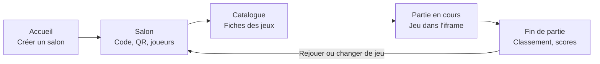
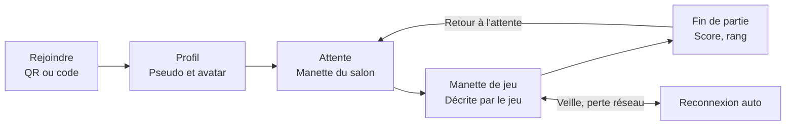

# EpiAirConsole : fonctionnement du site et parcours utilisateur

Guide pour développeurs · 20 novembre 2026

> Les choix techniques viennent du document de stack et restent à confirmer par ADR.
> Les schémas sont en Mermaid : GitHub, GitLab, VitePress et la plupart des éditeurs Markdown les affichent directement.

## 1. Vue d'ensemble

Le site se compose de trois éléments qui communiquent en temps réel par WebSocket :

- **La console** : l'application ouverte sur la TV ou le PC. Elle affiche le salon, le catalogue, et le jeu lui-même dans une iframe.
- **La manette** : l'application ouverte dans le navigateur du téléphone de chaque joueur. Elle n'a aucun écran fixe pendant la partie : elle affiche la manette que le jeu décrit.
- **Le serveur** : Fastify + `ws`. Il gère les salons, valide chaque message et ne fait confiance à aucun client.

Le jeu tourne dans une iframe sandbox de la console et parle à la plateforme uniquement via le SDK (`@sdk/screen`, par `postMessage`).

## 2. Les rôles

| Rôle | Où | Ce qu'il fait |
|---|---|---|
| Console | TV / PC | Crée le salon, affiche l'état, charge les jeux |
| Hôte | Téléphone du premier joueur | Joueur comme les autres, avec en plus : choisir et lancer un jeu, exclure un joueur |
| Joueur | Téléphone | Rejoint, joue, reçoit des messages privés et des vibrations |
| Jeu | Iframe de la console | Décrit les manettes, reçoit les actions, termine la partie avec des scores |
| Serveur | Node | Valide, route, gère reconnexion et fermeture des salons inactifs |

## 3. Parcours console (écran)

### 3.1 Accueil

- **Ce que voit l'utilisateur** : nom, logo, bouton « Créer un salon », lien vers la déclaration d'accessibilité.
- **Ce qui se passe** : au clic, la console ouvre le WebSocket et envoie `room.create`. Le serveur génère un code de 5-6 caractères (alphabet sans O/0/I/1), crée le salon en mémoire et répond par `room.state`. La console navigue vers `/room/:code`.

### 3.2 Salon (lobby)

- **Ce que voit l'utilisateur** : code en grand, QR code (`https://host/c/<code>`), avatars et pseudos des joueurs (4 max), indicateur de l'hôte.
- **Ce qui se passe** : la console écoute `player.joined`, `player.left` et `player.reconnected` pour mettre la liste à jour. Un salon sans activité est fermé automatiquement par le serveur.

### 3.3 Catalogue

- **Ce que voit l'utilisateur** : une fiche par jeu (description, nombre de joueurs, durée, options d'accessibilité), lancement en un clic.
- **Ce qui se passe** : la liste vient du `GameRegistry`, qui lit les `manifest.json` des dossiers `games/*`. Ajouter un jeu ne demande aucune modification de la plateforme. Le lancement envoie `host.startGame`, que le serveur accepte uniquement de l'hôte.

### 3.4 Partie en cours

- **Ce que voit l'utilisateur** : le jeu en plein écran, avec un overlay minimal (pause, quitter).
- **Ce qui se passe** : le serveur envoie `game.load`, la console charge le point d'entrée du manifeste dans une `<iframe sandbox="allow-scripts">`. Le jeu appelle `Epi.connect()`, puis `setController`, `sendPrivate`, `vibrate`, et reçoit les événements `playerJoin`, `playerLeave` et `input`. Un heartbeat `postMessage` tourne en permanence : sans signal pendant N secondes, ou en cas d'erreur, la console décharge le jeu, envoie `game.stop` et revient au salon sans le fermer.

### 3.5 Fin de partie

- **Ce que voit l'utilisateur** : classement et scores, boutons « Rejouer » et « Changer de jeu ».
- **Ce qui se passe** : le jeu appelle `game.end({ scores })`. « Rejouer » relance `game.load` avec le même jeu, « Changer de jeu » revient au catalogue. Les joueurs restent connectés dans les deux cas.

### 3.6 Mode développeur

- **Ce que voit l'utilisateur** : simulateur de manettes dans le navigateur, journal des messages, latence (p50 et p95).
- **Ce qui se passe** : le simulateur crée des joueurs virtuels qui utilisent le même protocole que les vrais téléphones. Il sert à tester un jeu sans téléphone.

## 4. Parcours manette (téléphone)

### 4.1 Rejoindre

- **Ce que voit l'utilisateur** : un champ pour le code du salon, pré-rempli si le QR code a été scanné.
- **Ce qui se passe** : validation côté client et côté serveur. En cas d'erreur (code inconnu, salon plein, trop de tentatives), le serveur répond par `error{code,hint}` et la manette affiche un message lié au champ avec une suggestion de correction.

### 4.2 Profil

- **Ce que voit l'utilisateur** : choix du pseudo et de l'avatar.
- **Ce qui se passe** : `room.join{code,nick,avatar}`. Le pseudo passe par le filtre de texte (longueur, normalisation Unicode, listes de mots FR et EN). Le serveur répond avec un jeton de joueur, que la manette stocke dans `sessionStorage` ou `localStorage`.

### 4.3 Attente

- **Ce que voit l'utilisateur** : confirmation de connexion et liste des joueurs. Sur le téléphone de l'hôte : « Choisir un jeu », « Lancer », « Exclure ».
- **Ce qui se passe** : le lobby est lui-même rendu par le système de manettes dynamiques. Le serveur envoie un `controller.set` avec un layout simple pour les joueurs et un layout enrichi pour l'hôte.

### 4.4 Manette de jeu

- **Ce que voit l'utilisateur** : les commandes du jeu en cours (boutons, croix, joystick, texte, choix multiple).
- **Ce qui se passe** : la manette reçoit un layout JSON via `controller.set` et le dessine. Chaque action part en `input{component,value}` avec un horodatage et un numéro de séquence. Le jeu peut changer le layout en cours de partie (vote, puis joystick), envoyer un `private.msg` à un seul joueur ou déclencher un `haptic{pattern}`. Côté navigateur : pas de zoom ni de défilement, écran maintenu allumé (Wake Lock) quand disponible.

### 4.5 Fin de partie

- **Ce que voit l'utilisateur** : son score et son rang, puis l'attente de la décision de l'hôte.
- **Ce qui se passe** : la manette revient au layout de lobby dès que la console relance ou change de jeu.

### 4.6 Reconnexion (transversal)

- **Déclencheurs** : `visibilitychange`, événement `online`, fermeture du WebSocket.
- **Ce qui se passe** : la manette envoie `resume{token}`. Le serveur garde la place du joueur pendant un délai de grâce, puis renvoie le layout courant et l'état. L'écran « Reconnexion en cours » reste visible tant que ce n'est pas rétabli.

## 5. Protocole en bref

Enveloppe commune : `{ v: 1, t: "type", ts: number, seq?: number, p: payload }`.

| Sens | Messages |
|---|---|
| Client → serveur | `room.create`, `room.join`, `resume`, `input`, `text.submit`, `choice.submit`, `host.startGame`, `host.kick`, `a11y.prefs`, `ping` |
| Serveur → client | `room.state`, `player.joined`, `player.left`, `player.reconnected`, `controller.set`, `private.msg`, `haptic`, `game.load`, `game.stop`, `error`, `pong` |

## 6. Ce que le serveur vérifie

- Le message respecte le schéma Zod.
- L'expéditeur appartient bien au salon.
- Le composant visé existe dans le layout courant de ce joueur (impossible d'envoyer « bouton B » si seul A existe).
- Les valeurs sont dans les plages autorisées (joystick entre -1 et 1).
- Le débit de messages respecte la limite par connexion et par IP.
- Seul l'hôte peut lancer, mettre en pause ou exclure.

## 7. États d'erreur à gérer

| Situation | Réaction attendue |
|---|---|
| Code de salon inconnu | Message sur le champ, suggestion de vérifier le code |
| Salon plein (4 joueurs) | Message clair, pas de plantage |
| Salon fermé pour inactivité | Console : écran d'information. Manette : retour à « Rejoindre » |
| Jeu planté ou bloqué | Console : retour au salon. Manette : retour au layout de lobby |
| Joueur exclu | Manette : message, retour à « Rejoindre » |
| Perte réseau ou veille du téléphone | Reconnexion automatique avec le jeton |

## 8. Accessibilité à respecter écran par écran

- HTML sémantique et titres hiérarchisés sur chaque écran.
- Un libellé sur chaque champ et chaque contrôle de la manette, y compris les composants dynamiques.
- Contraste de 4,5:1 minimum, information jamais portée par la seule couleur.
- Alternatives textuelles sur les avatars et images.
- Erreurs de formulaire explicites, liées au champ, avec suggestion.
- Options fournies par le SDK : taille du texte, désactivation des vibrations et des effets clignotants. Chaque jeu déclare celles qu'il gère dans son manifeste.

## 9. Où coder quoi

| Besoin | Dossier |
|---|---|
| Accueil, salon, catalogue, fin de partie, mode dev | `apps/console` |
| Rejoindre, profil, attente, rendu de manette | `apps/controller` |
| Salons, validation, limitation de débit, filtre de texte | `apps/server` |
| Schémas des messages (partagés) | `packages/protocol` |
| API utilisée par les jeux | `packages/sdk-screen`, `packages/sdk-controller` |
| Jeux et manifestes | `games/<nom>` |
